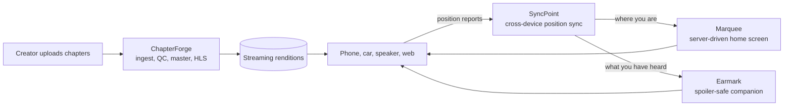

# Hi, I'm Jaya Chandra Dadi 👋

## Backend Software Engineer · Java · Distributed Systems · AWS

I build customer-facing backend services in **Java** and **Python**: services that keep working when networks drop, devices disagree, messages arrive twice and dependencies go down. I care about **correctness under concurrency**, **testability** and **operational excellence**, and I prove every claim with tests and benchmarks I can rerun.

I hold an **M.S. in Data Science (Computer Science and Applied Mathematics) from Stony Brook University**. My most recent work is a set of four connected services for **long-form audio**: keeping a listener's place in sync across devices, getting narrated audio from creators to streaming, assembling the app's home screen, and an LLM companion that never spoils the story.

📍 Houston, Texas  
📧 [jayachandradadi2003@gmail.com](mailto:jayachandradadi2003@gmail.com)  
🔗 [LinkedIn](https://www.linkedin.com/in/jaya-chandra-dadi-0abab6278)

---

## Featured: services for long-form listening

Each project stands alone, runs on a laptop with no cloud account, ships with CI and benchmark reports, and they fit together like this:

| Project | What it does | Stack | Measured |
|---|---|---|---|
| [**SyncPoint**](https://github.com/JayaChandraDadi/syncpoint) | Keeps a listener's playback position consistent across devices | Java 21, Spring Boot, DynamoDB, SNS/SQS, AWS CDK | 0 oracle mismatches in 2,000 randomized concurrent scenarios and 23K load-test requests |
| [**ChapterForge**](https://github.com/JayaChandraDadi/chapterforge) | Ingests narrated chapters, checks them against submission specs, masters and encodes them for streaming | Java 21, Spring Boot, S3, SQS, PostgreSQL, FFmpeg | 192/192 seeded-defect chapters classified exactly; 24/24 correct under injected crashes; 39x real time |
| [**Marquee**](https://github.com/JayaChandraDadi/marquee) | Server-driven UI: GraphQL screens for iOS, Android and web assembled from parallel downstream calls | Java 21, Spring Boot, GraphQL, DynamoDB, Redis | p99 583 → 182 ms at 4.2x throughput; p99 under 165 ms through outages |
| [**Earmark**](https://github.com/JayaChandraDadi/earmark) | Answers questions about a book using only what the listener has already heard | Python, FastAPI, Whisper, SQLite FTS5, ONNX, MCP | Spoiler bound never ran ahead across 2,000 random instants; 48 tests |

### [SyncPoint](https://github.com/JayaChandraDadi/syncpoint) · Cross-device listening-position sync

A listener's place in a 12-hour book has to survive phones going offline, retries on flaky networks, a car whose clock is an hour off, and a rewind on one device racing a report from another.

* Deterministic conflict resolution with a total order, so every arrival order of the same reports converges to the same state, plus **clock-skew correction** and **idempotent** retries.
* **Optimistic concurrency** with DynamoDB conditional writes: no locks, no transactions; the furthest point reached is kept separately, so progress is never lost.
* Changes fan out through **SNS** to per-instance **SQS** queues and are pushed to the listener's other devices over server-sent events.
* Verified against a sequential oracle in **2,000 randomized concurrent scenarios** (about 389K deliveries per run) and **23K load-test requests**, with **0 mismatches**. Infrastructure as code with **AWS CDK** (ECS Fargate, autoscaling, CloudWatch alarms).

`Java 21` `Spring Boot` `DynamoDB` `SNS` `SQS` `Server-Sent Events` `AWS CDK` `ECS Fargate` `CloudWatch` `JUnit`

---

### [ChapterForge](https://github.com/JayaChandraDadi/chapterforge) · Audiobook ingestion and quality-control pipeline

Most audiobook rejections are technical: too quiet, clipped peaks, a noisy room, missing room tone. ChapterForge measures every chapter, fixes what a machine can fix safely, and tells the creator exactly what to fix otherwise.

* Uploads land in **S3** under content-addressed keys, jobs go on **SQS**, and **PostgreSQL** tracks every chapter through validate → master → encode → publish.
* A streaming level meter checks loudness, peaks, noise floor and room tone against submission specs; safe fixes (gain, limiting, trimming, re-encoding) are automatic, and anything that would make the recording worse is refused with a fix-it report.
* **Exactly-once publishing on an at-least-once queue**: versioned leases, fencing tokens, heartbeats, retries with backoff, a dead-letter queue and a reconciler.
* **192/192** seeded-defect chapters classified exactly with **0 false positives** at **166x real time**; **24/24** chapters ended correctly under injected crashes and duplicate messages, at **39x real time**; multi-bitrate **AAC HLS** output via **FFmpeg**.

`Java 21` `Spring Boot` `S3` `SQS` `PostgreSQL` `Flyway` `FFmpeg` `HLS` `Micrometer`

---

### [Marquee](https://github.com/JayaChandraDadi/marquee) · Server-driven UI aggregation service

Home screens mix services that fail independently, and old app versions stay in use for months. Marquee moves screen composition to the server.

* Assembles home and library screens as typed component trees for **iOS, Android and web** through one **GraphQL** API, and adapts each component to the newest version the requesting app can draw.
* Fans out to catalog, progress and recommendation services in parallel on virtual threads under a single screen deadline, with per-dependency timeouts, **circuit breakers**, and fallbacks to each listener's last good copy or a shared editorial shelf.
* Layouts are data in **DynamoDB**, published with optimistic versioning and no app release; sticky **A/B test** assignments use hash bucketing plus conditional writes; **Redis** caches layouts, shared shelves and title metadata and fails open.
* Versus a sequential aggregator: **p99 583 → 182 ms at 4.2x throughput**, and **p99 under 165 ms** through a slow tail, a full outage, a 2-second dependency and a Redis outage (2.4 s for the baseline). Caching cut catalog calls per screen by **85%**.

`Java 21` `Spring Boot` `GraphQL` `DynamoDB` `Redis` `Resilience4j` `Virtual Threads` `Prometheus`

---

### [Earmark](https://github.com/JayaChandraDadi/earmark) · Spoiler-safe listening companion

Ask "who is this character again?" halfway through a book and get an answer that only uses what you have already heard.

* Maps the listener's SyncPoint position to the exact text heard by aligning **Whisper** word timestamps to the book; the spoiler bound never runs ahead of the narrator (verified across 2,000 random instants).
* Position-bounded **hybrid search** (BM25 on SQLite FTS5 + dense embeddings, fused with reciprocal-rank fusion) that never returns text past the bound.
* A guard rejects **LLM** answers that name characters the listener has not reached yet, and falls back to an extractive answer that is spoiler-free by construction.
* Conversational discovery over the LibriVox catalog ("a short gothic novel for a 6-hour flight"), served through **FastAPI** and an **MCP server**; 48 tests in CI.

`Python` `FastAPI` `Whisper` `SQLite FTS5` `ONNX` `Embeddings` `RAG` `MCP` `pytest`

---

## Experience

* **Open Source Contributor, vLLM** (Sep 2026 – present): exploring the vLLM inference engine (request scheduling, KV-cache management, model execution) and investigating gaps in testing and reliability, aiming to contribute fixes and regression tests.
* **Research Assistant (Visiting Scholar), Stony Brook University** (Aug 2026 – present): an LLM-powered retrieval system over 500K+ documents, an automated evaluation pipeline that catches regressions on every change, and Spark/Dask data processing.
* **AI/ML Backend Engineering Intern, Marketeq Digital** (May – Aug 2025): backend microservices and REST APIs on PostgreSQL, Redis and Kafka serving 50K+ daily requests, shipped on Docker and Kubernetes with CI/CD.

---

## Technical Skills

**Languages**  
`Java` `Python` `TypeScript` `JavaScript` `SQL` `Go` `C++`

**Backend and APIs**  
`Spring Boot` `REST APIs` `GraphQL` `FastAPI` `NestJS` `gRPC` `Server-Sent Events` `Microservices`

**Cloud and Infrastructure**  
`AWS` `DynamoDB` `S3` `SQS` `SNS` `ECS Fargate` `AWS CDK` `CloudWatch` `Azure` `Docker` `Kubernetes` `GitHub Actions`

**Databases and Messaging**  
`DynamoDB` `PostgreSQL` `MySQL` `Redis` `SQLite` `Kafka` `SQS/SNS` `Spark` `Dask`

**Media**  
`FFmpeg` `HLS` `AAC` `Whisper`

**AI and Search**  
`RAG` `LLM Evaluation` `Embeddings` `Hybrid Search (BM25 + vector)` `MCP` `LangChain` `LangGraph` `vLLM`

**Engineering Practices**  
`JUnit` `pytest` `Load Testing` `Fault Injection` `Code Review` `Prometheus` `CloudWatch Alarms` `CI/CD` `Agile`

---

## How I build

* **Correctness first, proven by tests.** Concurrency claims are checked against an oracle, failure handling against injected faults.
* **Failure is a normal path.** Retries, duplicates, timeouts and outages are designed for, measured and reported, not left to chance.
* **Numbers I can rerun.** Every project has a benchmark command and a committed results file.
* **Runs on a laptop.** DynamoDB Local, embedded PostgreSQL, ElasticMQ, S3Mock and real Redis start inside the tests, so anyone can clone and verify.

---

## More projects

* [**Distributed Sharded Transaction Engine**](https://github.com/JayaChandraDadi/Distributed-Sharded-Transaction-Engine): banking transactions across shards and nodes, with gRPC communication, transaction routing and benchmarked workloads. `Python` `gRPC` `Protocol Buffers`
* [**Byzantine Fault-Tolerant Consensus Engine**](https://github.com/JayaChandraDadi/Byzantine-Fault-Tolerant-Consensus-Engine): consensus that keeps working when some nodes misbehave, with simulated Byzantine nodes, quorum decisions and replication. `Python` `gRPC` `Protocol Buffers`
* [**DealRoom**](https://github.com/JayaChandraDadi/dealroom): document analysis with source-grounded answers, built on FastAPI, local embeddings and semantic retrieval with a React front end. `FastAPI` `React` `TypeScript` `Ollama`

Practice: [LeetCode](https://github.com/JayaChandraDadi/leetcode) (algorithms and data structures) · [Low-Level Design](https://github.com/JayaChandraDadi/LowLevelDesign) (object-oriented design and design patterns)

**Coursework:** Data Structures and Algorithms, Object-Oriented Design, Distributed Systems, Operating Systems, Database Systems, Cloud Computing, Big Data Systems, Machine Learning, Large Language Models

---

## Connect

I'm looking for software engineering roles building **backend and distributed systems for products people use every day**, especially audio, media and listening experiences.

📧 [jayachandradadi2003@gmail.com](mailto:jayachandradadi2003@gmail.com)  
🔗 [LinkedIn](https://www.linkedin.com/in/jaya-chandra-dadi-0abab6278)  
💻 [GitHub](https://github.com/JayaChandraDadi)
