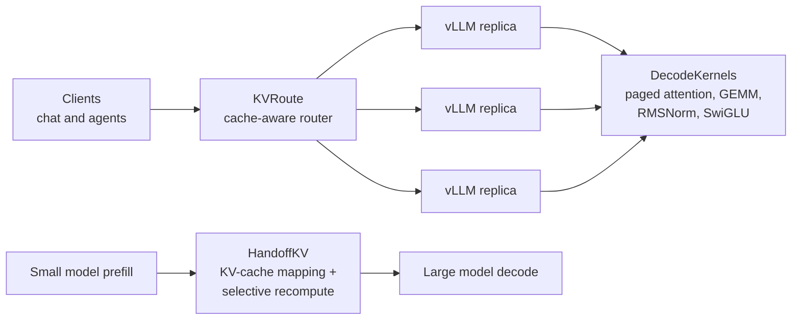

# Hi, I'm Jaya Chandra Dadi 👋

## GPU Computing · LLM Inference · AI Systems

I work on the layer between a trained model and a fast, reliable service: **CUDA C++ kernels** for decoding, **vLLM** serving and scheduling, and **KV-cache** reuse. I profile before I tune, measure against the strongest baseline available (cuBLAS, FlashInfer, vLLM's own backends), and publish a number only once a rerunnable benchmark has produced it.

I hold an **M.S. in Data Science (Computer Science and Applied Mathematics) from Stony Brook University**. My recent work covers three levels of the inference stack: the kernels a decode step runs on, the router that decides which GPU replica serves a request, and reusing a small model's KV cache so a large model can skip most of its prefill.

📍 Houston, Texas  
📧 [jayachandra.dadi@gmail.com](mailto:jayachandradadi00@gmail.com)  
🔗 [LinkedIn](https://www.linkedin.com/in/jaya-chandra-dadi-0abab6278) · [LeetCode](https://leetcode.com/u/JayaChandraDadi)

---

## Featured: across the LLM inference stack

Each project stands on its own, comes with tests and CI, and states plainly what has been measured and what hasn't. Here is where each one sits in the inference stack:

| Project | What it does | Stack | Status |
|---|---|---|---|
| [**DecodeKernels**](https://github.com/JayaChandraDadi/DecodeKernels) | CUDA kernels for the LLM decode step, wired into vLLM as custom ops | CUDA C++, PyTorch C++ extensions, Nsight Compute, vLLM | 102 kernel instantiations compile for sm_80/89/90 with 0 register spills; GPU benchmarks vs cuBLAS and FlashInfer in progress |
| [**KVRoute**](https://github.com/JayaChandraDadi/KVRoute) | Routes each request to the vLLM replica that balances prefix-cache hits against load | Python, aiohttp, vLLM, Docker, Prometheus, Grafana | Simulated 4-replica agent workload vs round-robin: median TTFT 0.173 → 0.064 s, hit rate 66% → 81%, 1276 → 1500 tok/s; GPU runs in progress |
| [**HandoffKV**](https://github.com/JayaChandraDadi/handoffkv) | Converts a small model's KV cache for a larger model and recomputes only the tokens that matter | Python, PyTorch, OpenAI Triton, Hugging Face | Triton sparse-causal kernel does 0.45–0.56x the work of dense attention at 4K context; 45 correctness tests |

### [DecodeKernels](https://github.com/JayaChandraDadi/DecodeKernels) · CUDA kernels for LLM decoding

Decode is memory-bound: each new token rereads the whole KV cache and every weight matrix. These kernels go after that cost directly, and they plug into a real serving engine.

* **Paged-attention decode** over vLLM's KV cache in place. Each block is GQA-aware, so one block owns a KV head and serves its whole query group. That way each K/V row is read from HBM once per group instead of once per query head.
* **Flash-decoding split-K** for long contexts. Each 512-token partition writes its partial output plus its max logit and exp-sum. A reduce kernel then merges the partitions with a log-sum-exp rescale. Short batches take a single-pass path.
* A **tensor-core GEMM** (WMMA) with `cp.async` double buffering, plus a skinny tile for decode-sized batches.
* Fused **RMSNorm**, **residual-add + RMSNorm** and **SiLU-and-mul**. They use warp-level reductions and match vLLM's op signatures.
* Registered through `torch.library`, with fake kernels for `torch.compile`. A **vLLM plugin** swaps them into the FlashAttention decode path. Parity scripts check them against vLLM's default backend, and end-to-end throughput scripts measure the same model.
* A CI compile check runs ptxas for sm_80/89/90 without a GPU. CPU reference tests cover the split-K merge math. CUDA-event benchmarks and Nsight Compute scripts run against **cuBLAS** and **FlashInfer**.

`CUDA C++` `WMMA` `cp.async` `PyTorch C++ Extensions` `torch.library` `vLLM` `FlashInfer` `cuBLAS` `Nsight Compute`

---

### [KVRoute](https://github.com/JayaChandraDadi/KVRoute) · Cache-aware request router for vLLM replicas

With several vLLM replicas, the choice of replica decides whether a prompt's prefix (system prompt, chat history, agent tool schemas) is already cached. Pile every request onto the replica that has the prefix and it overloads. Spread requests evenly and they all miss the cache.

* An OpenAI-compatible **aiohttp** proxy with streaming passthrough, failover and per-request attribution headers.
* A router-side **prefix index**. It hashes 16-token blocks in a chain, the same way vLLM does, and keeps one LRU index per replica sized from that replica's `num_gpu_blocks`.
* Five routing policies:
  * round-robin
  * least-load
  * prefix affinity
  * weighted linear
  * **LMetric** (OSDI '26): new prefill tokens × batch size, lowest score wins, with no weights to tune.
* **Trace replay** of multi-turn chat and agent workloads. It reports TTFT p50/p99, end-to-end p99, time per output token, throughput, and both the router's estimated hit rate and the replicas' measured one.
* **Prometheus** metrics, scraped from vLLM and the router: queue depth, KV-cache usage and hit rate. A provisioned **Grafana** dashboard shows them, and Docker Compose brings up 4 GPU replicas (or 4 on one GPU).
* Simulated replicas use a cost model, not GPU timings. In that simulation LMetric had the best median TTFT, end-to-end p99 and throughput. Every cache-aware policy had a worse TTFT p99 than round-robin, and the README reports that too.

`Python` `aiohttp` `vLLM` `Prefix Caching` `Docker Compose` `NVIDIA Container Toolkit` `Prometheus` `Grafana` `pytest`

---

### [HandoffKV](https://github.com/JayaChandraDadi/handoffkv) · Cross-model KV-cache reuse

A reimplementation of RaReCache: a small model does the prefill, and the large model reuses that work instead of starting from scratch.

* A fitted linear map converts the small model's **KV cache** into the large model's layout. **Rank-disagreement scoring** then picks which tokens the large model must recompute.
* A fused **Triton** sparse-causal attention kernel skips masked query-key blocks. At 4K context it does **0.45–0.56x** the work of dense attention, verified for MHA, GQA, MQA and FP16.
* **45** correctness tests. They include partial prefill matching a full prefill to 1e-4, and padded-batch equivalence across Qwen3 and Llama layouts.

`Python` `PyTorch` `OpenAI Triton` `Hugging Face Transformers` `KV Cache` `GQA`

---

## Experience

* **Research Assistant, GPU Computing and AI Systems, Stony Brook University** (Aug 2026 – present):
  * Runs a **vLLM** serving stack on NVIDIA GPUs for LLM agents and for retrieval over 500K+ documents.
  * Runs **multi-GPU tensor-parallel** inference with NCCL and compares AWQ and FP8 checkpoints.
  * Profiles prefill and decode with **Nsight Systems**.
  * Maintains an inference evaluation pipeline that tracks quality, TTFT, tokens/s and GPU memory.
* **ML Systems Engineering Intern, Marketeq Digital** (May – Aug 2025):
  * Built PyTorch **inference services** behind REST and gRPC that handled 50K+ daily requests.
  * Added dynamic batching, mixed precision and result caching on GPU workers.
  * Deployed with **Docker** and the NVIDIA Container Toolkit on **Kubernetes** GPU nodes.

---

## Technical Skills

**Languages**  
`C++` `C` `Python` `CUDA` `SQL` `Bash`

**GPU and AI Computing**  
`CUDA C++` `OpenAI Triton` `PyTorch` `vLLM` `TensorRT-LLM` `NCCL` `FlashInfer` `LLM Inference`

**Inference Optimization**  
`Paged KV Cache` `Continuous Batching` `Prefix Caching` `AWQ` `FP8 Quantization` `Speculative Decoding` `Tensor Parallelism`

**Systems and Infrastructure**  
`Linux` `Docker` `Kubernetes` `NVIDIA Container Toolkit` `FastAPI` `gRPC` `Redis` `Kafka` `Git` `GitHub Actions`

**Performance and Debugging**  
`Nsight Systems` `Nsight Compute` `PyTorch Profiler` `CUDA Events` `Prometheus` `Grafana` `GDB`

---

## How I build

* **Profile first.** Optimizations target what Nsight or the profiler shows is actually slow, not what looks slow.
* **Measure against the strongest baseline.** cuBLAS for GEMMs, FlashInfer for attention, vLLM's own backends end to end.
* **Correctness before speed.** Every kernel has a PyTorch reference and tolerance-checked tests, including edge cases such as partition boundaries, GQA ratios and padded batches.
* **Honest numbers.** Results come from committed benchmark scripts. Simulated results are labeled as simulated, and anything not yet measured on a GPU is marked that way.

---

## More projects

* [**Distributed Sharded Transaction Engine**](https://github.com/JayaChandraDadi/Distributed-Sharded-Transaction-Engine): banking transactions across shards and nodes, with gRPC communication, transaction routing and benchmarked workloads. `Python` `gRPC` `Protocol Buffers`
* [**Byzantine Fault-Tolerant Consensus Engine**](https://github.com/JayaChandraDadi/Byzantine-Fault-Tolerant-Consensus-Engine): consensus that keeps working when some nodes misbehave, with simulated Byzantine nodes, quorum decisions and replication. `Python` `gRPC` `Protocol Buffers`

Practice: [LeetCode](https://github.com/JayaChandraDadi/leetcode) (500+ problems solved)

**Coursework:** Computer Architecture, Operating Systems, Distributed Systems, Deep Learning, Large Language Models

**Hackathons:** Harvard Rare Disease Hackathon · 5th Series AI Hackathon

---

## Connect

I'm looking for roles in **GPU computing, LLM inference and AI systems**: kernels, serving engines and the infrastructure that makes models fast and reliable in production.

📧 [jayachandra.dadi@gmail.com](mailto:jayachandra.dadi@gmail.com)  
🔗 [LinkedIn](https://www.linkedin.com/in/jaya-chandra-dadi-0abab6278)  
💻 [GitHub](https://github.com/JayaChandraDadi)
